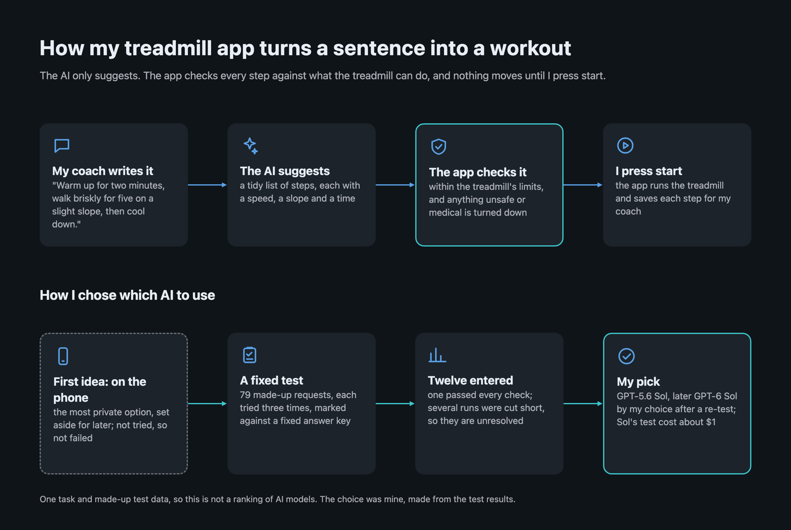
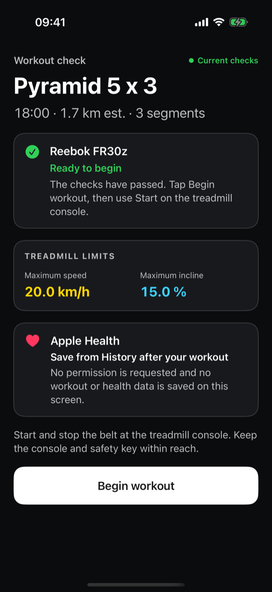
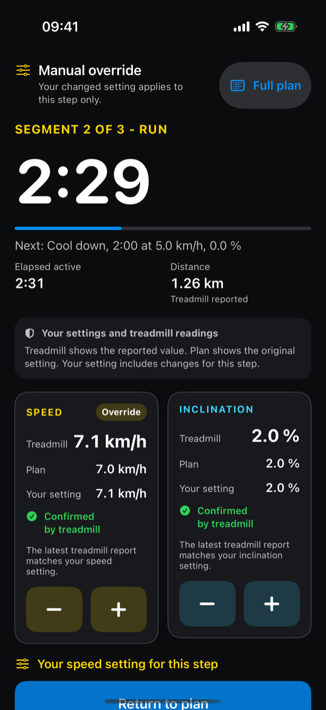
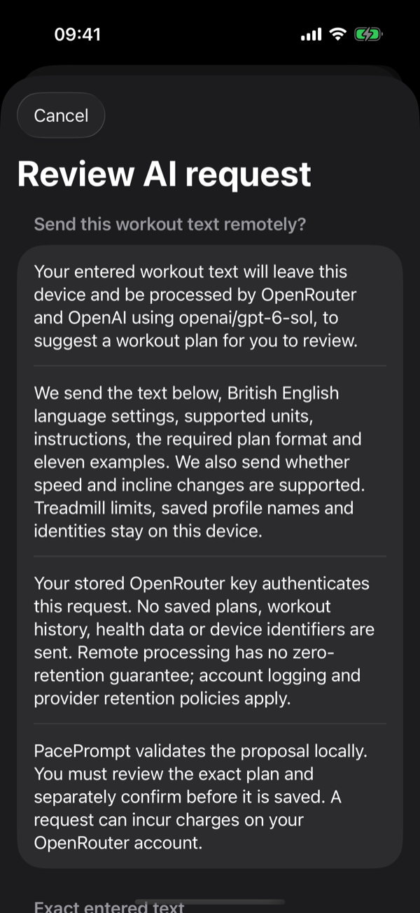
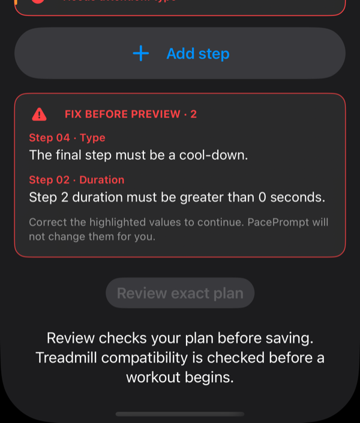

# PacePrompt

[](https://app.codecov.io/gh/syamaner/paceprompt-ios)

PacePrompt is a local-first iPhone app that turns plain-English interval workouts into validated treadmill plans and runs them on a Reebok FR30z over Bluetooth FTMS (Fitness Machine Service), with the person at the treadmill console always in charge of the belt.

It is a personal app for one person and one treadmill model, not a general FTMS library. The code was written by a coding agent (Codex) under the rules in [`AGENTS.md`](AGENTS.md); the product decisions, safety principles and physical treadmill sessions were mine. The story behind it is in the blog post [Driving a Treadmill From a PDF Specification](https://sertan.com/driving-a-treadmill-from-a-pdf-specification/).



## Safety principles

A treadmill can hurt someone, so these were set before any code was written, and the build enforces them rather than leaving them to review.

1. **The console owns the belt.** The app has no Start, Stop or Pause command. The belt is started, paused and stopped on the treadmill; the app only adjusts speed and incline while it is moving.
2. **Three commands, one door.** The app can send only Request Control, Set Target Speed and Set Target Inclination, through a single reviewed Bluetooth write path ([`CoreBluetoothFTMSControlPointLink`](PacePrompt/Bluetooth/CoreBluetoothFTMSControlPointLink.swift)).
3. **Only the treadmill it was tested on.** Control stays off unless the machine's reported capabilities match the real FR30z byte for byte. Any other treadmill stays read-only.
4. **Check again before every command.** Immediately before each write, the app rechecks the connection, the current step, that it is in the foreground, the treadmill's limits, that its readings are fresh, and the target's range and increment ([`ProductionWorkoutExecutionBinding`](PacePrompt/Execution/ProductionWorkoutExecutionBinding.swift)).
5. **AI proposes; local code decides.** An imported workout is an untrusted suggestion. Local code validates every step against the treadmill's limits, never clamps or rounds a value, and nothing is saved until the person reviews the exact plan and confirms it.
6. **Nothing leaves the phone without asking.** Each AI request is disclosed in full and agreed to first. There is no account, analytics, telemetry or cloud storage.

<table>
  <tr>
    <td width="25%"></td>
    <td width="25%"></td>
    <td width="25%"></td>
    <td width="25%"></td>
  </tr>
  <tr>
    <td>The checks pass; the belt starts at the console.</td>
    <td>A setting counts as confirmed only when the treadmill reports it.</td>
    <td>Every AI request is disclosed first.</td>
    <td>Invalid plans are blocked, never silently fixed.</td>
  </tr>
</table>

<sub>Simulator screenshots with synthetic data.</sub>

## How the build enforces them

| Check | Runs on |
| --- | --- |
| One Bluetooth write path, no Start/Stop/Pause route, no state restoration ([verifier](scripts/verify_treadmill_control_surface.py) plus [tests that prove it fails](scripts/tests/test_treadmill_control_surface.py)) | Every pull request and the local gate |
| Exact command bytes, the capability match and the pre-write rechecks (codec, transport and execution-binding unit tests) | Every pull request and the local gate |
| Plan validation, import mapping and the workout-import [evaluation corpus](Evaluation/WorkoutImport/README.md) | Every pull request and the local gate |
| Built app binaries contain no leftover diagnostic command | Local gate |

## Evidence on the real treadmill

Simulator and CI runs prove software behaviour only. Physical behaviour comes from separately authorised, supervised sessions:

- [Request Control proof, 10 September 2026](docs/validation/fr30z-request-control-success-2026-09-10.md): one exact command, one well-formed acknowledgement, no belt movement.
- [Console and target characterisation, 11 September 2026](docs/validation/fr30z-console-target-characterisation-2026-09-11.md): speed and incline targets acknowledged and then reported back exactly. FTMS Start and Stop did not give reliable physical control, which is why principle 1 exists.
- [End-to-end workout proof, 13 September 2026](docs/validation/fr30z-workout-proof-success-2026-09-13.md): a five-minute workout through physical pause, resume and Stop, supervised and confirmed by the operator.

## Build and test

Xcode 26.6 (iOS SDK 26.5), Xcode 27.0 or Xcode 27.2, plus `uv` with Python 3.13 for the offline evaluation tests. Before merging any change, run the complete local gate:

```sh
scripts/validate_local.sh
```

It runs every offline Python test, all unit and UI tests with coverage, the unsigned Release build, static analysis and the developer-only evaluation tests, and makes no model-provider call.

## More detail

- [Technical overview](docs/technical-overview.md): full scope, architecture, privacy, build, CI, TestFlight and evidence notes.
- [`AGENTS.md`](AGENTS.md): the rules the coding agent works under.
- [`DEVELOPMENT_NOTES.md`](DEVELOPMENT_NOTES.md): a process experiment recording per-change agent token use. It is not a bill and not evidence of productivity or quality.

[MIT licensed](LICENSE).
